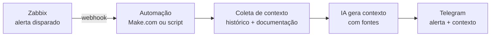

# Da Hipótese à Evidência: Contexto de Alertas com IA para Plantão de TI

> Case de Product Discovery e validação de produto. Disciplina **Metodologias Ágeis e Validação de Produtos** (UniFECAF).
>
> **Autor:** Lucas Sgorlon Ribeiro (RA 229363) · **Período do experimento:** outubro/2026 · **Vídeo pitch:** https://youtu.be/Sq06pA5pj3Y

---

## Resumo do case

| | |
|---|---|
| **Problema** | Profissionais de TI que tratam alertas de monitoramento perdem tempo até saber o que fazer, principalmente no plantão |
| **Hipótese inicial** | Um resumo gerado por IA (o que aconteceu, gravidade, causas prováveis, primeiro passo) acelera a primeira ação |
| **Experimento** | Teste de protótipo assíncrono via formulário, com 3 alertas reais anonimizados comparados com seus resumos por IA |
| **Participantes** | 6 profissionais de TI, sendo 4 da escala de plantão |
| **Principal aprendizado** | O tempo não é gasto decifrando o alerta, e sim **buscando contexto** (documentação, histórico, informações do cliente) |
| **Decisão** | **AJUSTAR**: manter o problema e o público, e evoluir a solução de "resumo do alerta" para "contexto do alerta", com fontes rastreáveis |

---

## 1. Problema, público e oportunidade

### Problema
Quando um alerta dispara, especialmente fora do horário comercial, quem está de plantão precisa entender rapidamente o que aconteceu, qual o impacto e por onde começar. Os alertas das ferramentas de monitoramento costumam trazer só dados técnicos crus (título do trigger, host, severidade, valor medido). O profissional precisa complementar essas informações consultando histórico, documentação, colegas ou o próprio cliente.

### Público
Profissionais de TI que recebem e tratam alertas de monitoramento (Suporte, NOC, Infraestrutura, Redes), com ou sem escala de plantão, usando ferramentas como Zabbix, Grafana, PRTG e similares.

### Oportunidade
Modelos de IA já conseguem interpretar dados técnicos e produzir explicações em linguagem simples. Se essa interpretação reduzir o tempo até a primeira ação, há espaço para um produto que se integre às ferramentas de monitoramento existentes, sem substituí-las.

---

## 2. Hipóteses e critérios de sucesso

Os critérios foram definidos **antes** da coleta de dados.

| # | Hipótese | Critério de validação |
|---|---|---|
| H1 | **Problema:** quem trata alertas perde tempo relevante entendendo-os antes de agir | ≥ 60% relatam o problema como frequente |
| H2 | **Solução:** um resumo por IA deixa o alerta mais claro e acelera a primeira ação | ≥ 70% preferem receber o resumo **e** clareza média ≥ 4 (escala 1–5) |
| H3 | **Valor:** existe interesse real em usar a solução | ≥ 40% deixam contato para testar a versão beta |

### Regra de decisão (definida previamente)

| Resultado | Decisão |
|---|---|
| H1, H2 e H3 confirmadas | Perseverar |
| Problema confirmado, mas a solução precisa de outro formato ou conteúdo | Ajustar |
| O problema real é outro | Pivotar |
| O problema é raro ou irrelevante | Abandonar |

---

## 3. Solução proposta e MVP

**Solução inicial:** ao disparar um alerta, a IA gera um resumo estruturado em quatro partes:
1. O que aconteceu (em linguagem simples)
2. Gravidade e impacto provável
3. Causas mais prováveis (até 3)
4. Primeiro passo recomendado

**Definição do MVP:** nada foi desenvolvido. O MVP foi um **teste de protótipo** (abordagem "Mágico de Oz"): os resumos foram gerados manualmente com IA, a partir de alertas reais, e apresentados aos participantes como se fossem a saída do produto. O objetivo era validar se o resumo tem valor **antes** de investir em integração e automação.

### Por que esse experimento
O plano original era um concierge MVP durante plantões reais. Ele se mostrou inviável por duas restrições:
- só 2 pessoas fazem plantão no ambiente de origem do problema;
- a janela de execução era curta.

Por isso, o público foi ampliado para profissionais de TI de outras áreas e empresas, e o experimento passou a ser assíncrono via formulário.

---

## 4. Como a IA foi utilizada no discovery

| Etapa | Uso da IA | Papel humano |
|---|---|---|
| Exploração | Levantamento de possíveis problemas e caminhos de solução | Escolha do problema com base na vivência de plantão e no acesso a usuários |
| Estruturação | Formulação das hipóteses, critérios e regra de decisão | Ajuste dos critérios e do público à realidade disponível |
| Protótipo | Geração dos resumos dos 3 alertas com um prompt padronizado | Seleção e anonimização dos alertas; revisão técnica dos resumos |
| Coleta | Redação das perguntas do formulário e da mensagem-convite | Divulgação para colegas e grupos de TI |
| Análise | Tabulação das respostas e identificação de padrões | **Interpretação final e decisão** |

**Prompt padrão usado nos resumos:**

```
Você é um assistente de plantão de TI. Com base no alerta abaixo, gere um resumo curto contendo:
1. O que aconteceu (1 frase, linguagem simples)
2. Gravidade e impacto provável
3. Causas mais prováveis (até 3)
4. Primeiro passo recomendado (ação concreta)

Alerta: [alerta anonimizado]
```

> **Regra seguida:** a IA apoiou o processo, mas nenhuma conclusão deste case se baseia em respostas geradas por IA. Toda evidência vem dos participantes.

---

## 5. Experimento executado

### Alertas utilizados (anonimizados)

| Alerta | Tipo | Severidade original | Por que foi escolhido |
|---|---|---|---|
| COND-A-NVR-02 | Consumo de banda > 95% em gravador de CFTV | — | Problema de desempenho, sem queda |
| COND-B-ANT-01 | Equipamento indisponível (ICMP down) | High | Indisponibilidade total |
| COND-C-ENDPOINT-05 | Perda de pacotes de 100% há mais de 8h | **Warning** | A severidade subestima o problema; testa se a IA agrega interpretação |

Os nomes de hosts, IPs e IDs foram substituídos para não expor clientes.

### Formulário (Google Forms, 15 perguntas, cerca de 5 minutos)
- **Seção 1, Perfil:** área, plantão, ferramenta, volume de alertas
- **Seção 2, Problema:** tempo até entender o último alerta, fontes consultadas, frequência de alertas pouco claros, maior dificuldade
- **Seção 3, Teste:** clareza do original vs. resumo, agilidade, erros ou lacunas
- **Seção 4, Valor:** preferência de formato, requisitos de confiança, interesse no beta

### Perfil dos participantes (n = 6)

| Característica | Distribuição |
|---|---|
| Área | Suporte (3) · NOC (1) · Outra (2) |
| Faz plantão | Sim (4) · Não (2) |
| Ferramenta | Zabbix (2) · Grafana (1) · Outra (3) |
| Alertas por semana | Menos de 10 (2) · 10 a 30 (2) · Mais de 30 (2) |

---

## 6. Resultados

### H1, Problema: **parcialmente confirmada**

| Indicador | Resultado |
|---|---|
| Levaram 5 min ou mais para saber o que fazer no último alerta | **5 de 6** (2 deles, mais de 15 min) |
| Relatam que o alerta chega frequentemente sem clareza (nota ≥ 4) | **1 de 6** (média 2,7) |
| Fonte mais consultada | **Documentação (4 de 6)** · histórico (1) · cliente ou local (1) |

A dor existe, mas **não está no texto do alerta**. Ninguém apontou o alerta em si como a maior dificuldade. Os relatos falam de outras coisas:
- informação vaga vinda do cliente ou do usuário;
- regras de negócio sem documentação clara ou inexistente;
- descobrir qual é o verdadeiro problema da ocorrência;
- comunicação e escalonamento para o setor responsável.

### H2, Solução: **parcialmente confirmada**

| Indicador | Meta | Resultado |
|---|---|---|
| Preferem receber o resumo (alerta + resumo) | ≥ 70% | **6 de 6** ✅ |
| O resumo agilizaria o primeiro passo ("sim, muito") | — | **5 de 6** |
| Clareza média do resumo | ≥ 4 | **3,5** ❌ (original: 2,7) |
| Clareza: resumo vs. original, por participante | — | Melhorou em 4 · igual em 2 · piorou em 0 |

Ninguém escolheu receber **só** o resumo. Todos querem o resumo **junto** do alerta original.

**Lacunas apontadas no resumo:**
- O ID dos dispositivos deveria aparecer no resumo.
- Para câmeras e endpoints, faltam IP, local, tempo offline e histórico de intermitências.

### H3, Valor: **confirmada**

| Indicador | Meta | Resultado |
|---|---|---|
| Deixaram contato para testar o beta | ≥ 40% | **4 de 6** ✅ |
| Entre quem faz plantão | — | **3 de 4** |

Um participante deu notas baixas de clareza ao resumo e mesmo assim deixou contato. Isso indica interesse no **problema**, não necessariamente nesta versão da solução.

### O que gera confiança em um resumo de IA

| Requisito citado | Participantes |
|---|---|
| Dados comprovados, logs auditáveis, informações testadas e conferidas | 3 |
| Assertividade, sem alarmes desnecessários (ex.: falha de energia) | 1 |
| Ser útil na prática | 1 |
| Nada específico | 1 |

---

## 7. Hipótese inicial vs. resultados

| O que acreditávamos | O que os dados mostraram |
|---|---|
| O problema é o alerta ser difícil de entender | O problema é **reunir o contexto** necessário para agir |
| Um resumo simplificado resolveria | Simplificar demais **remove dados operacionais essenciais** (ID, IP, local, tempo offline) |
| O resumo poderia substituir o alerta | Os usuários querem o resumo **como complemento**, nunca como substituto |
| A IA seria aceita pela utilidade | A confiança depende de **rastreabilidade**: mostrar de onde vem cada conclusão |

---

## 8. Decisão: AJUSTAR

Pela regra definida antes do experimento, a decisão é **ajustar**:

- **Não perseverar como está:** a clareza do resumo ficou abaixo da meta, e o problema real se mostrou diferente do imaginado.
- **Não pivotar nem abandonar:** o problema existe (5 de 6 levam 5 min ou mais) e há interesse real (4 de 6 querem testar).

### Hipótese para o próximo ciclo

> **Contexto do alerta, em vez de resumo do alerta.** Ao disparar um alerta, a IA entrega junto ao alerta original:
> - identificadores operacionais (ID, IP, local);
> - tempo offline e histórico de intermitências do host;
> - o trecho relevante da documentação ou runbook;
> - causa provável e primeiro passo, **sempre com a fonte de cada informação**.
>
> **Critério do próximo ciclo:** reduzir o tempo até a primeira ação para menos de 5 min em pelo menos 60% dos casos, medido em plantão real.

### Desenho da solução futura (somente se o próximo ciclo validar)



### Próximos passos recomendados
1. Conversar com os 4 participantes que deixaram contato para validar a hipótese de "contexto do alerta".
2. Mapear quais fontes de contexto (documentação, histórico, cadastro do cliente) estão acessíveis de forma estruturada.
3. Repetir o teste com a nova versão, medindo o tempo em plantão real.

---

## 9. Conversas de aprofundamento

Foram feitas 2 conversas com participantes que deixaram contato no formulário. As perguntas abertas vieram **antes** da apresentação da ideia ajustada ("contexto do alerta"), para evitar viés. Os participantes não autorizaram a gravação em áudio, e a decisão foi respeitada. As respostas abaixo foram registradas em anotações durante a conversa.

### Entrevistado A ([função - Analista de rede] · [faz plantão? Não]). Perfil experiente
- **O que mais pesa ao agir:** identificar o dispositivo. Com nomes genéricos no alerta, a localização para acesso não é intuitiva.
- **Fonte mais consultada:** logs de acesso.
- **O que falta hoje:** saber se o equipamento é reincidente e ter dados mais precisos para acesso.
- **Reação à ideia:** mudaria completamente. Com essas informações, poderia direcionar a energia à raiz do problema em vez de investigar a causa.
- **Confiança:** a ameaça é a "alucinação" na sugestão de primeiro passo. Quem conhece o sistema sabe o que faz sentido, e excesso de informação desnecessária prejudicaria a confiança.

### Entrevistado B ([função - Suporte técnico] · [faz plantão? Sim]). Perfil em adaptação
- **O que mais pesa ao agir:** a configuração dos alertas tornou a leitura vaga, sem as informações necessárias para agir.
- **Fonte mais consultada:** clientes (quais equipamentos estão com problema) e colegas (o que testar e como prosseguir).
- **O que falta hoje:** ainda não tem familiaridade com a linguagem dos alertas. Algo mais claro e de fácil entendimento ajudaria muito.
- **Reação à ideia:** ajudaria com certeza, porque muitas vezes eliminaria a necessidade de procurar cliente ou colegas para entender o cenário.
- **Confiança:** confiaria. Informações falsas e sugestões vagas ou fora do contexto do serviço tirariam a credibilidade.

### O que as conversas acrescentaram

| Achado | Impacto na solução |
|---|---|
| Os dois confirmam que o contexto reduziria o tempo até agir | **Reforça a decisão de AJUSTAR** |
| **Dois perfis** com necessidades diferentes: o experiente quer precisão e pouco texto, o iniciante quer linguagem clara | Considerar níveis de detalhe por perfil. Explica a nota de clareza dividida no formulário |
| A causa-raiz está, em parte, na **configuração do monitoramento** (nomes genéricos, IDs sem manutenção) | A qualidade da solução **depende da qualidade dos dados de origem**. Oportunidade: sinalizar alertas mal configurados |
| A **sugestão de primeiro passo** é o principal risco à confiança | Priorizar dados de contexto verificáveis. A sugestão só deve aparecer quando estiver baseada em documentação ou runbook, com a fonte citada |

---

## 10. Limitações

- **Amostra pequena (n = 6).** Os resultados são **direcionais**, não estatisticamente conclusivos. Por isso são apresentados como "X de 6", e não em porcentagem.
- **Dois participantes estão fora do público principal** (não fazem plantão e tratam menos de 10 alertas por semana).
- **As perguntas de avaliação (9 a 12) foram respondidas uma única vez**, e não por alerta. Não é possível saber qual dos três alertas mais pesou na avaliação.
- **A anonimização removeu identificadores** que os próprios participantes apontaram como essenciais, o que pode ter reduzido a nota de clareza do resumo.
- **Teste de percepção, não de comportamento.** O tempo economizado foi estimado pelos participantes, não medido.

---

## 11. Aprendizados

1. **Validar antes de construir economizou um ciclo inteiro.** Se a automação tivesse sido desenvolvida, ela resolveria o problema errado (clareza do texto) em vez do real (falta de contexto).
2. **Perguntar sobre comportamento passado revela mais do que perguntar sobre intenção.** A pergunta "qual a parte mais difícil?" mostrou o problema real.
3. **Restrições de mercado mudam o experimento, não o objetivo.** Com poucos plantonistas e prazo curto, ampliar o público e trocar o concierge por um teste assíncrono manteve a validação viável.
4. **Confiança é requisito de produto em IA.** Para esse público, uma IA que não mostra suas fontes não será usada, por melhor que seja o texto.

---

## Estrutura do repositório

```
├── README.md                  # Este documento
├── parte-teorica/             # Documento de hipóteses e estratégia de validação
├── canvas/
│   └── lean-canvas.png        # Lean Canvas do produto
├── experimento/
│   ├── formulario.pdf         # Perguntas do formulário
│   ├── alertas-anonimizados.md
│   └── resumos-ia.md          # Resumos gerados e prompt utilizado
└── evidencias/
    ├── respostas.csv          # Respostas (contatos removidos por privacidade)
    └── graficos/              # Gráficos usados no pitch
```

> **Privacidade:** os contatos deixados pelos participantes foram removidos da base pública e substituídos por "Deixou contato" / "Não deixou". Hosts, IPs e IDs dos alertas foram anonimizados.
